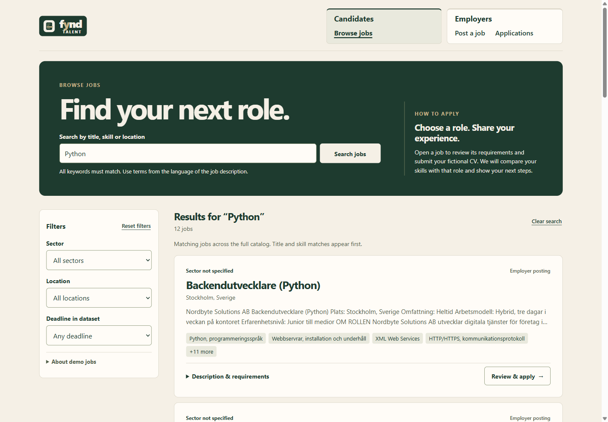
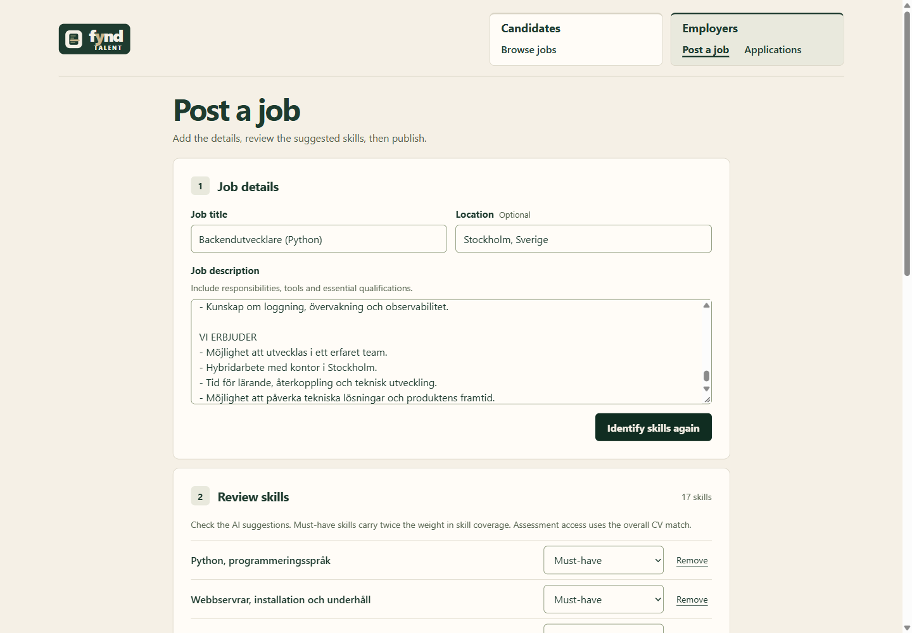
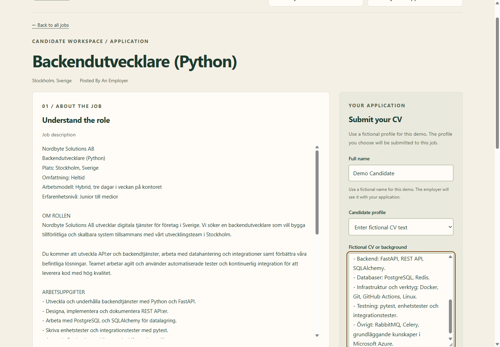
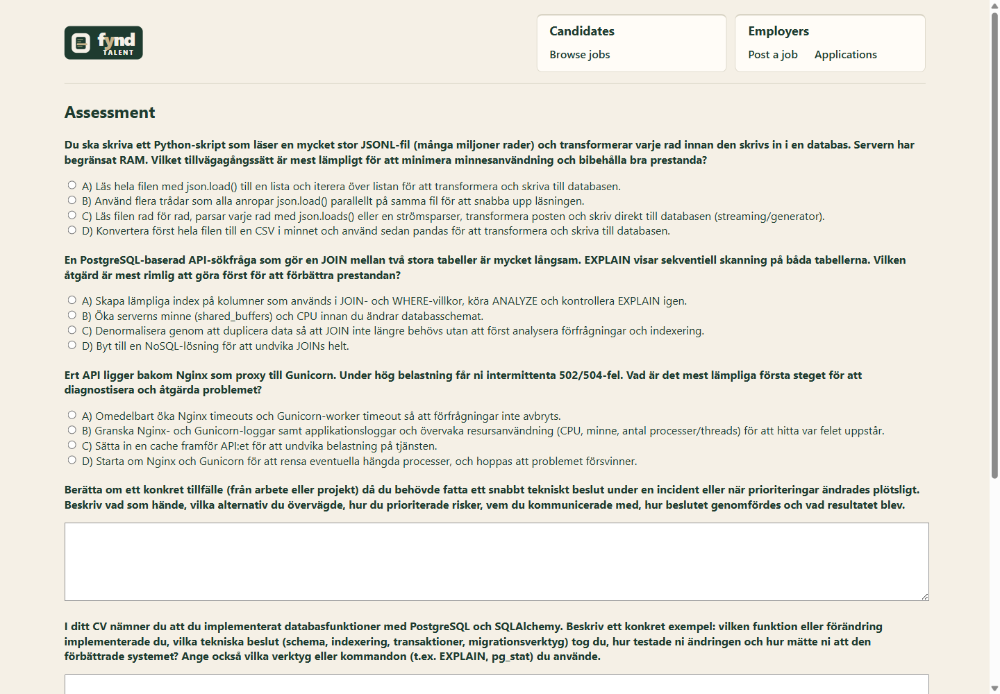
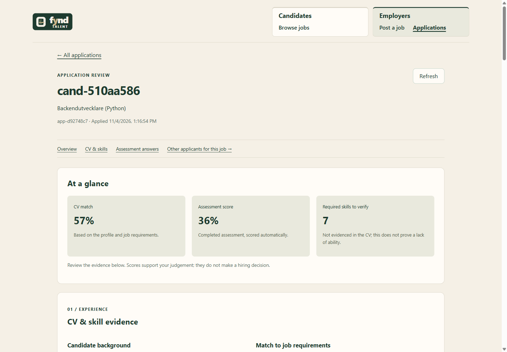
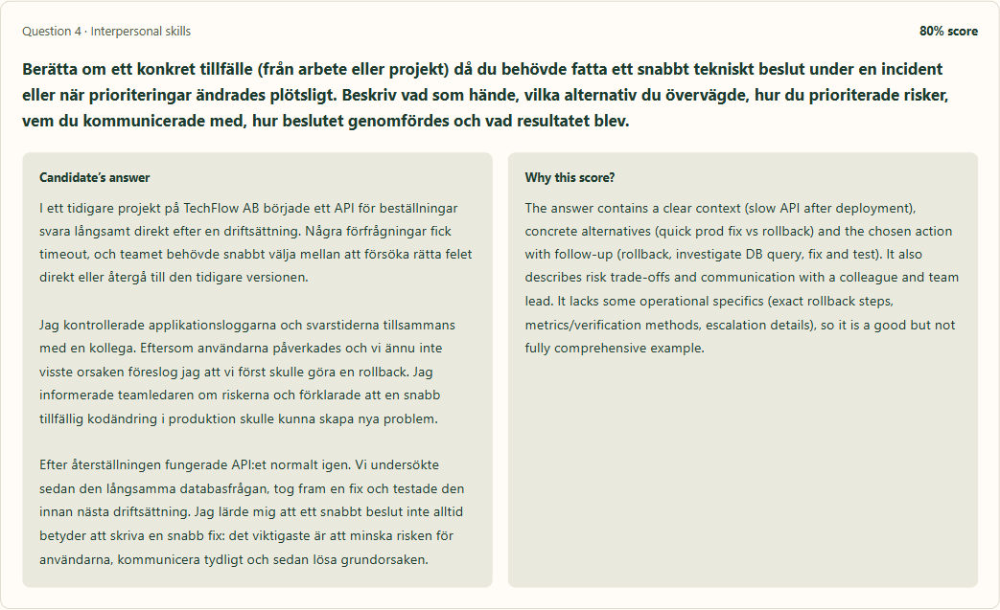
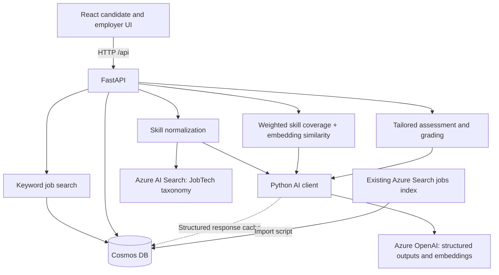

<p align="center">
  
</p>

# Fynd Talent

**See the skills behind the CV.**

A skills-based hiring prototype that connects CV evidence to job requirements and gives employers a clearer view of candidates through tailored assessments.

Built during the two-day **AI:spire hackathon, 3–4 November 2026**. Fynd Talent combines a React interface, a Python API and Azure AI services in a working candidate-to-employer workflow. It is a demonstration with fictional candidate data, not a production recruitment system.

[Product walkthrough](#product-walkthrough) · [Architecture](#architecture--ai-integration) · [Run locally](#running-locally) · [Limitations](#limitations--next-steps)

## Overview

When AI can help write a CV and screen it, a convincing application still leaves an important question unanswered: how well can the candidate demonstrate what the role requires?

Fynd Talent starts with the employer's expectations. Employers define the role, review the required skills, distinguish must-haves from nice-to-haves, and specify what candidates should demonstrate in an assessment. They also set the minimum CV match percentage needed to access that assessment. The CV provides initial evidence; a tailored assessment then explores relevant knowledge, practical judgement, claimed experience and skills not evidenced in the CV.

Employers can review the candidate's answers alongside scores and concise AI-generated explanations for written responses. These explanations describe how an answer meets the assessment criteria, where it falls short and why it received its score, helping the employer interpret the response rather than rely on a percentage alone.

The goal is to connect employer-defined requirements with evidence that a person can inspect. Assessments provide additional information, not proof of independently demonstrated ability: candidates may use AI to answer, and automated grading can be imperfect. The final hiring decision stays with the employer.

## How it works

1. **Define the job.** An employer enters a description, reviews AI-suggested skills, sets their importance and configures assessment access.
2. **Apply to a specific role.** A candidate browses jobs, reviews the requirements and submits fictional CV text or selects a supplied synthetic profile.
3. **Compare the evidence.** The backend identifies skills, maps them to JobTech concepts and calculates the CV match.
4. **Explore skills through assessment.** Candidates meeting the numerical entry threshold can answer tailored technical, situational, experience-based and gap-probing questions.
5. **Review the application.** The employer inspects CV evidence, answers, scores and saved explanations on a dedicated application page. Below-threshold applications remain available for review.

## Key features

- **One job catalog:** keyword search across imported and employer-created jobs, with location, sector and deadline filters.
- **Employer-reviewed requirements:** AI skill suggestions, must-have/nice-to-have weighting and internal assessment instructions separate from the public description.
- **Evidence-based matching:** taxonomy concept IDs, original CV quotes, and distinct labels for directly supported, inferred and missing skills.
- **Tailored assessments:** multiple-choice questions and written responses, with saved scoring explanations for AI-graded answers.
- **Application review:** a searchable inbox and individual detail pages, including a CV snapshot for new applications.
- **Clear feedback during processing:** AI loading states, error recovery and explanatory assessment controls with reduced-motion support.

## Product walkthrough

Screenshots were captured from the local prototype using demo data. The interface is in English; job content and assessment questions retain Swedish. See [capture notes](docs/images/README.md) for the sample and capture method.

### 1. Browse jobs

Search titles, skills, descriptions and locations. All search terms must match, and title/skill matches rank ahead of description-only matches. Ordinary keyword search does not call an AI model.



### 2. Define and review job requirements

The employer reviews extracted skills before publishing. Suggestions can be removed or assigned different importance. The assessment entry score controls access; the separate target score is currently stored for reference only.



### 3. Submit a CV for the chosen role

The application page brings the job description and candidate input together. The prototype accepts pasted text or synthetic profiles; it does not upload PDF or DOCX files.



### 4. Complete a tailored assessment

Questions test relevant skills and explore experience that may not be explicit in the CV. Multiple-choice answers use a saved answer key; written responses are scored against generated rubrics.



*This screen replays previously generated questions in the real assessment UI. No new attempt or result was saved for the screenshot.*

### 5. Inspect the evidence behind an application

The employer sees the CV match, assessment result and skills requiring further verification. Each question has a separate answer-and-explanation view; the interface explicitly identifies missing explanations rather than inventing them.





## Technology stack

| Layer | Technologies | Purpose |
|---|---|---|
| Frontend | React 18, TypeScript, Vite, React Router, CSS | Candidate and employer workflows |
| API | Python, FastAPI, Pydantic, Uvicorn | Validation, orchestration and HTTP endpoints |
| AI | Azure OpenAI through Azure AI Foundry; OpenAI Python SDK | Skill extraction, concept selection, questions, written-answer grading and embeddings |
| Retrieval | Azure AI Search, JobTech taxonomy | Hybrid keyword/vector retrieval of candidate skill concepts |
| Persistence | Azure Cosmos DB | Jobs, profiles, applications, assessments and structured LLM response cache |
| Service identity | Azure Identity / DefaultAzureCredential | Local Azure CLI credentials and managed-identity support |
| Testing | pytest, HTTPX/FastAPI TestClient, TypeScript compiler | Backend regression tests and frontend type checks |
| Packaging | Multi-stage Dockerfile | Built React assets and FastAPI in one image |

The supplied hackathon environment used **GPT-5 mini** and **text-embedding-3-small (1,536 dimensions)**. Deployment names are configurable. Query embeddings must match the model and dimensions used to create the existing vector indexes.

## Architecture & AI integration



### From text to comparable skills

1. **Extract:** the model returns skill phrases and supporting evidence in a Pydantic-validated structure.
2. **Retrieve:** hybrid search returns up to five taxonomy candidates for each phrase, filtered to skill concepts.
3. **Select:** a model chooses a retrieved concept or `none`. Python rejects IDs outside the retrieved set.
4. **Store:** concept IDs, labels and candidate evidence are retained for matching and review.

The prompts are designed around English candidate backgrounds and Swedish job/taxonomy content. Candidate skill phrases are requested in Swedish while evidence remains in its original language. This is not a general-purpose translation service.

### Matching and assessment scoring

```text
CV match = 0.70 × weighted skill coverage + 0.30 × embedding cosine similarity
```

Skill coverage gives full credit to directly supported skills, half credit to inferred skills and zero to missing skills. Must-have skills have weight 2; nice-to-have skills have weight 1. These are prototype heuristics, not calibrated hiring probabilities.

Assessment generation requests six questions: three technical multiple-choice questions and one each for situational judgement, CV experience and a skill gap. Multiple-choice grading runs in Python. Written-answer grading uses the stored rubric and returns a score plus reasoning. Overall and per-skill assessment scores are averages of the relevant question scores.

AI calls are orchestrated by application code, not autonomous agents. Structured chat responses are cached in Cosmos by a hash of the deployment, purpose, prompt/input and schema name. Embeddings are requested separately. Application overview summaries use stored evidence rather than another model call.

### Search is separate from recommendations

The visible job search reads the Cosmos catalog and ranks literal keyword matches, including newly posted jobs. Hybrid retrieval is used for skill normalization and a retained backend recommendation endpoint. The standalone recommendation page was deliberately removed so candidates choose a role before submitting their CV. New jobs are not automatically written into the Azure Search index.

## Running locally

**Requirements:** Python 3.12+, Node.js 20+, Azure CLI, and access to configured Azure OpenAI deployments, populated Search indexes and Cosmos containers. Cloud resources and starter datasets are not provisioned or bundled by this repository. The original lab resources may be temporary; cloning the repository alone does not provide a self-contained demo.

The commands below use Windows PowerShell. See [RUNNING.md](RUNNING.md) for required fields, data roles, container names, starter-data import and troubleshooting.

```powershell
az login
if (-not (Test-Path .env)) { Copy-Item .env.example .env }
```

Fill in the placeholders in `.env`, then start the backend:

```powershell
python -m venv .venv
.\.venv\Scripts\python.exe -m pip install -r requirements-dev.txt
.\.venv\Scripts\python.exe -m uvicorn app.main:app --reload
```

In another terminal:

```powershell
cd frontend
npm install
npm run dev -- --strictPort
```

Open [the app](http://localhost:5173) or [interactive API documentation](http://localhost:8000/docs). Vite proxies `/api` requests to FastAPI on port 8000. Local development does not require Docker or Compose.

A production-target Dockerfile is included for packaging. A public deployment is not provided or verified by this README.

## Engineering decisions

- **A common vocabulary instead of matching titles alone.** Taxonomy IDs connect differently worded skills, while evidence quotes make mappings reviewable. Incorrect or overly specific mappings remain a known limitation.
- **Keyword search and semantic retrieval serve different needs.** Hybrid retrieval initially returned loosely related jobs even for meaningless queries. Job browsing now uses explicit keyword matches; taxonomy retrieval still benefits from vectors.
- **One application catalog.** An insert-only sync imports missing starter jobs into Cosmos without overwriting employer-created records. Newly created jobs are immediately searchable there.
- **Keep public descriptions and assessment guidance separate.** Internal instructions influence questions and rubrics without being shown in the candidate job description.
- **Preserve the submitted evidence.** New applications store a candidate snapshot, so subsequent profile changes do not silently replace the CV under review.
- **Make latency visible.** Cached structured responses and clear loading/error states support a workflow where first-time AI processing can take several minutes.

## Validation

On **5 November 2026**, the offline backend suite reported **41 passed, 5 skipped**; the frontend TypeScript check passed. Tests cover matching, keyword search, catalog synchronization, profile handling, application review and selected assessment/API behavior. Skipped tests are unfinished coverage, not successful checks. These results do not establish model accuracy, fairness or production readiness.

```powershell
.\.venv\Scripts\python.exe -B -m pytest -q -p no:cacheprovider
cd frontend
npx tsc --noEmit
npm run build
```

The separate `python -m scripts.smoke_check` requires Azure access and makes model calls. Do not confuse it with the offline test suite.

## Limitations & next steps

- **Demo access model:** no user authentication, employer isolation or authorization. Use synthetic data; this is not a private recruitment portal.
- **Incomplete privacy protection:** basic preprocessing removes email addresses and phone numbers from selected inputs. It does not comprehensively anonymize CVs or written answers. Displaying a candidate ID is not anonymization.
- **Experimental AI evaluation:** taxonomy choices and generated rubrics can be imperfect. There is no measured hiring-quality or fairness benchmark, and no proctoring or verification of qualifications/licences.
- **Reference-only target:** the assessment target does not implement pass/fail decisions. The match threshold controls assessment access; there is no automated hiring/rejection workflow.
- **Limited input and language scope:** no document upload/parsing, no keyword translation, Swedish assessment questions, and English/Swedish written-answer grading prompts.
- **Prototype persistence and scale:** drafts and in-progress answers are not restored after reload. Catalog and employer reads load small datasets in memory; pagination and scoped queries would be needed at scale. Requests are synchronous, and backend assessment creation/submission is not an idempotent workflow.
- **Operational work remains:** reproducible dependency locks, CI, broader automated UI tests, deployment automation and full Search index synchronization.

Priority improvements are access control, data protection, a labelled evaluation set for matching/grading, reliable resumable assessments, and a reproducible demo setup independent of the original lab.

## Repository guide

```text
app/
  api/          FastAPI routes
  models/       Request, response and stored-document schemas
  services/     AI, search, scoring, storage and application review
  prompts/      Versioned model instructions
frontend/       React interface and branding assets
scripts/        Azure smoke checks and data import/preprocessing
tests/         Backend tests
docs/          Screenshots and preserved development brief
```

[RUNNING.md](RUNNING.md) contains the operational setup guide. [docs/initial-brief.md](docs/initial-brief.md) preserves the previous development README, including its later additions; it describes historical intentions and is not the final specification.
